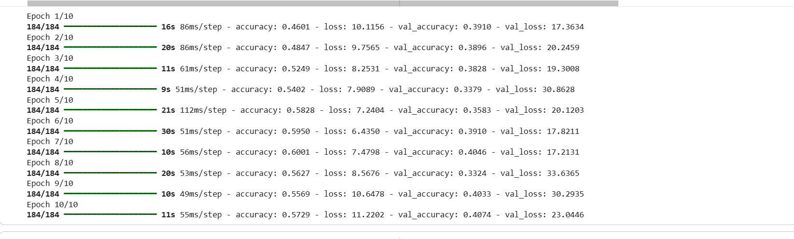
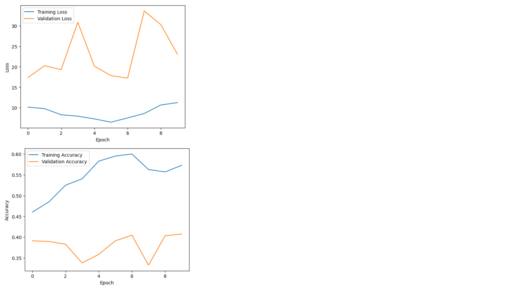
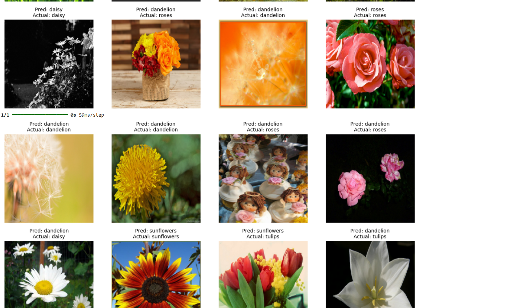

# Flower Image Classification Using a Shallow Neural Network

In this project I built a complete image classification pipeline from scratch with TensorFlow and Keras, training a shallow neural network to sort 3,670 flower photos into five categories.

I worked through every stage myself: preparing and splitting the dataset, building an efficient `tf.data` input pipeline, designing the network, training it, and evaluating the results against clear reference points. Starting with a shallow network was a deliberate choice. It let me see how flattening, fully connected layers, Softmax, and the loss function each affect learning, and identify exactly where a simple model reaches its limits. This foundation sets up the next stage of the project: deeper networks and CNNs.

## Dataset

The project uses the [TensorFlow flower_photos dataset](https://storage.googleapis.com/download.tensorflow.org/example_images/flower_photos.tgz), featured in the [Load and preprocess images](https://www.tensorflow.org/tutorials/load_data/images) tutorial. It contains 3,670 JPG images in five folders.

| Label | Flower | Images |
|:-----:|:-------|-------:|
| 0 | Daisy | 633 |
| 1 | Dandelion | 898 |
| 2 | Roses | 641 |
| 3 | Sunflowers | 699 |
| 4 | Tulips | 799 |
| | **Total** | **3,670** |

The images were split 80/20 (stratified) into a training set of 2,936 images and an evaluation set of 734 images. The paths and labels are saved in `train_set.csv` and `eval_set.csv`.

## Preprocessing

- Decode each image to RGB (3 channels)
- Resize to 224 × 224 pixels
- Scale pixel values from 0–255 to 0–1
- Group into batches of 16 and prefetch with `tf.data`

Each batch has shape `(16, 224, 224, 3)` with labels of shape `(16,)`.

## Model

| Layer | Output | Purpose |
|:------|:-------|:--------|
| Flatten | 150,528 | Turns each image into a single row of pixel values |
| Dense (Softmax) | 5 | Gives a probability for each flower |

There are no hidden or convolutional layers. The model was compiled with the Adam optimiser, Sparse Categorical Crossentropy loss, and accuracy as the metric, then trained for 10 epochs.

## Results

Before looking at the results, I set two simple reference points to judge whether the model was actually learning. With five flower categories, guessing at random would be correct about 20% of the time. Because dandelion is the largest category (898 of 3,670 images), a model that always guessed dandelion would score about 24.5%. I calculated these values from the dataset; they do not come from the training log.

In my experiment, the model reached 39.10% validation accuracy in the first epoch, already well above both reference points. This showed me that it was picking up some useful patterns from the images, not just guessing.

| Epoch | Train Acc | Train Loss | Val Acc | Val Loss |
|:-----:|----------:|-----------:|--------:|---------:|
| 1 | 46.01% | 10.1156 | 39.10% | 17.3634 |
| 2 | 48.47% | 9.7565 | 38.96% | 20.2459 |
| 3 | 52.49% | 8.2531 | 38.28% | 19.3008 |
| 4 | 54.02% | 7.9089 | 33.79% | 30.8628 |
| 5 | 58.28% | 7.2404 | 35.83% | 20.1203 |
| 6 | 59.50% | 6.4350 | 39.10% | 17.8211 |
| 7 | 60.01% | 7.4798 | 40.46% | 17.2131 |
| 8 | 56.27% | 8.5676 | 33.24% | 33.6365 |
| 9 | 55.69% | 10.6478 | 40.33% | 30.2935 |
| 10 | 57.29% | 11.2202 | 40.74% | 23.0446 |

The graphs number epochs from 0 to 9, so graph epoch 0 is Epoch 1 in the table.

Training accuracy peaked at 60.01% in Epoch 7 and finished at 57.29%. Training loss was lowest in Epoch 6 (6.4350) and then rose to 11.2202 by Epoch 10, so training did not improve steadily. Validation accuracy stayed between 33.24% and 40.74% and finished at 40.74%. Validation loss was high and unstable, with spikes in Epochs 4 and 8. The model beats both reference points (20% and 24.5%). However, validation accuracy is 15 to 23 percentage points below training accuracy from Epoch 5 onwards, which suggests it does not generalise well to new images.

## Predictions

The image above is a manual inspection of the model's predictions on evaluation images. Each image shows the model's prediction (Pred) and the true flower (Actual), so they can be compared by eye.

Some images were predicted correctly: 6 of the 12 shown, including a daisy, a rose, three dandelions, and a sunflower. The other 6 were wrong. The model predicted "dandelion" for 8 of the 12 images, including three roses, a daisy, and a tulip, which may point to a bias towards dandelion, the largest class.

## Limitations

- The model works on raw pixels and cannot learn shapes, edges, or textures.
- With no hidden layers, it can only learn simple (linear) patterns.
- Validation accuracy was low and inconsistent from epoch to epoch.
- The prediction check is a manual inspection of only 12 images, so it cannot represent the whole evaluation set. The overall validation accuracy of 40.74%, measured on all 734 evaluation images, is the more reliable measure.

## Next Steps

- Add hidden layers with ReLU activation
- Try a Convolutional Neural Network (CNN)
- Evaluate with a confusion matrix and per-class precision, recall, and F1-score
- Compare all models on the same data split

## Tools

Python, TensorFlow, Keras, NumPy, Pandas, Matplotlib, Google Colab

## References

1. TensorFlow. [Load and preprocess images](https://www.tensorflow.org/tutorials/load_data/images)
2. TensorFlow. [Flower Photos dataset](https://storage.googleapis.com/download.tensorflow.org/example_images/flower_photos.tgz)
3. Google. [Google Colab](https://colab.research.google.com/)
